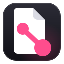

<div align="center">



# Netblog

a small gtk4/libadwaita blog manager for [buwryy.net](https://buwryy.net)

[](LICENSE)
[](VERSION)

</div>

---

netblog is mostly a personal tool. it reads and writes the buwryy.net blog gist on [gist.buwryy.net](https://gist.buwryy.net) through the Opengist API.

## requirements

- rust and cargo
- gtk4, libadwaita, gtksourceview5 and webkitgtk 6 development headers
- `curl`
- an Opengist personal access token with the `gist:read` and `gist:write` scopes
- a gist containing `blog.json`, the blog file

## install

```bash
git clone https://git.buwryy.net/buwryy/buwryy.net.git
cd buwryy.net/netblog
./setup.sh
```

the installer builds the release binary and adds the launcher, icon and desktop entry under `~/.local`.

## configuration

netblog reads the token from `NETBLOG_OPENGIST_TOKEN`, or from `~/.config/opengist/api-token`.

it uses the buwryy.net blog gist on `https://gist.buwryy.net` by default. point it somewhere else with:

```bash
NETBLOG_OPENGIST_URL=https://gist.example.com \
NETBLOG_GIST_ID=your_gist_id \
NETBLOG_OPENGIST_TOKEN=og_... \
netblog
```

## license

GPL-3.0-or-later. see [LICENSE](LICENSE).
