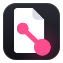

<div align="center">



# Netblog

a small gtk4/libadwaita blog manager for [buwryy.net](https://buwryy.net)

[](LICENSE)
[](VERSION)

</div>

---

netblog is mostly a personal tool. it reads and writes the buwryy.net blog gist through the GitHub CLI, using the same account you already use in the terminal.

## requirements

- rust and cargo
- gtk4, libadwaita, gtksourceview5 and webkitgtk 6 development headers
- [GitHub CLI](https://cli.github.com/) installed and signed in with `gh auth login`
- a GitHub gist containing `blog.json`, the blog file

## install

```bash
git clone https://github.com/buwryme/buwryy.net.git
cd buwryy.net/netblog
./setup.sh
```

the installer builds the release binary and adds the launcher, icon and desktop entry under `~/.local`.

## configuration

netblog uses the buwryy.net blog gist by default. point it at another gist with:

```bash
NETBLOG_GIST_ID=your_gist_id netblog
```

## license

GPL-3.0-or-later. see [LICENSE](LICENSE).
